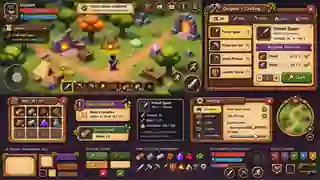

# OUTPOST — In-game UI Visual Polish & Crafting UX Blueprint

**Owner:** In-game UI agent • **Project:** Five Star Interactive / Outpost / Godot 4.7.2 Android landscape • **Target:** current \`main\`  
**Status:** Design brief and implementation instructions; **not** a claim that the final artwork or interactions are finished.  
**Source code:** https://github.com/Smurfis/outpost-rpg  
**Design baseline:** the approved Outpost pixel-fantasy title screen + the approved in-game UI concept.

## Approved visual reference

**READ THIS FIRST:** The image above is a **small reference preview of the approved composite mock-up**, not an in-game screenshot and not a complete set of ready-to-use sprites. It shows desired style, hierarchy and art treatment. **Never use the single composite image as a clickable interface**; recreate it as separate live Godot controls and transparent assets. The full-resolution 1672 × 941 reference was supplied in the originating ChatGPT conversation. Do not pretend this reduced preview is the full art source.

In the visual reference, the top-left illustrates a clean gameplay HUD with a portrait, health/secondary bar, collapsible quests, contextual joystick, actual item hotbar and circular action controls. The top-right depicts **crafting** in a much smaller wood-and-parchment station panel. The lower examples are **bag**, **quest/item toasts**, **item tooltips**, **settings**, **minimap**, and a showcase of separate **transparent frames, button states, icons and badges**. The illustration includes speculative ideas such as mana, item durability, level 10, capacity 24/30 and a minimap; **do not invent or display these as real gameplay values before systems exist**.

Existing working title menu is a separate, integrated feature. This assignment is **in-game UI polish**, not replacing the title screen.

## Current mainline reality — do not duplicate or revert it

As of 4 Nov 2026, \`main\` already includes the initial pixel-art crafting/HUD integration, the Five Star title screen, terrain/voxel/dungeon/co-op/torch work and Android follow-up changes. Read \`main\` freshly before editing: code changes faster than this document.

| Existing implementation | Actual file |
| --- | --- |
| HUD, movement joystick, gathering/attack/craft/bag/heal buttons, quest text, clock, torch and co-op entry | \`scripts/hud.gd\` |
| Craft / Bag / Equipment overlays, recipe transitions, manual workshop actions, equipment preview | \`scripts/menu.gd\` |
| Real nine-sliced image theme and fallback styles | \`scripts/ui/outpost_skin.gd\` |
| Touch-swipable recipe/detail scrolling | \`scripts/ui/touch_scroll_container.gd\` |
| Actual craft, station, items, inventory, HP and save rules | \`scripts/game.gd\`, \`data/recipes.json\`, \`scripts/station.gd\` |
| PNG frames, buttons, original action art | \`assets/ui/frames/\`, \`assets/ui/buttons/\`, \`assets/ui/icons/\` |
| Existing item/material icons | \`assets/icons/\` |
| Title menu motifs | \`assets/ui/title/\` |

The current crafting flow is already **browse recipe → inspect/detail → prepare/load ingredients → manually work station → result**. Do not regress to a two-column fullscreen interface; polish the current **single-recipe-focused** flow and make it feel like actual objects the player touches.

### Goals and non-goals

**Goals:** reduce screen obstruction, make every action obvious without reading walls of text, establish premium handcrafted fantasy art across HUD/crafting/bag/gear/tooltips/toasts/settings, maintain landscape phone usability, and use the same colour and icon language as the title menu.

**Non-goals:** rewriting craft recipes, adding fake stats, requiring new currencies, inventing dungeon rewards, changing the save format, altering combat/co-op protocol, removing existing buttons, or using proprietary Albion Online graphics. Borrow the **interaction pattern**, not their artwork.

## Art direction — build one consistent visual system

Use warm **parchment** for content, dark **carved wood** for structural frames/navigation, bronze/brass edge pixels for emphasis, green for actionable craft/equip, muted red for destructive actions, purple for quest/special notifications, and high-contrast dark ink on light content. The target looks closer to a small hand-painted tabletop RPG inventory than a stock Godot form. Forest leaves, rivets, rope, stone and small flourishes should be tasteful and never obstruct text.

| Design token | Hex | Usage |
| --- | --- | --- |
| Parchment | \`#E8D0A2\` | Surface behind text and requirements |
| Parchment light | \`#FAE8BD\` | Selected cards/details |
| Walnut wood | \`#79502D\` | Frames, tabs and toolbar |
| Dark wood | \`#38271D\` | HUD backplates, deep inset backgrounds |
| Ink | \`#342416\` | Text on parchment |
| Cream | \`#F9E9C2\` | Text on wood/dark backgrounds |
| Brass/gold | \`#E3B75D\` | Edges and equipped/selected focus |
| Success green | \`#42663A\` | Craft/confirm when genuinely enabled |
| Action red | \`#773A31\` | Attack/cancel/danger |
| Quest purple | \`#6E477E\` | Quest cards and distinct special accent |

Existing art **already committed to main** (use it before generating new assets):
- \`assets/ui/frames/parchment_panel.png\`, \`dark_wood_panel.png\`, \`item_card.png\`, \`toast_card.png\`, \`transparent_wood_frame.png\`.
- \`assets/ui/buttons/wood_normal.png\`, \`wood_pressed.png\`, \`green_normal.png\`, \`red_normal.png\`.
- \`assets/ui/icons/{attack,gather,craft,bag,heal}.png\` and their SVG versions.
- Existing \`assets/icons/*.svg\` represent wood, stone, iron, spear, torch, etc.

The PNGs are RGBA with transparent edges. Use \`StyleBoxTexture\` or \`NinePatchRect\` rather than resizing complete artwork (which stretches corners). For 128 × 128 panels, start from **16 px margins**; for 192 × 64 buttons, **18 px left/right and 12 px top/bottom**. Nearest texture filtering on pixel artwork. Keep small-font text at native readable resolution; pixel art does not mean blurry microtype. Don’t copy opaque dark squares from the old interface or recreate them under parchment.

Create missing icons, frames, active/pressed/disabled states as **individual reusable files**, committed and licensed in-repo. Google Material Symbols may be used for neutral temporary system actions subject to proper asset/font licensing and a consistent treatment, but prefer the existing original Outpost sprites. Every control still needs live Godot hit testing.

## A. Gameplay HUD — persistent but quiet

**Target:** keep the playable world visible; remove giant solid blocks and stacked text. See the **upper-left** of the concept art.

**Top-left:** compact hero portrait medallion with an optional actual level badge; red **HP numerator/denominator** and progress bar, XP as a genuinely calculated progress value, current equipped weapon only where useful. Do not present mana or \`xp % 100\` as a fictitious real level curve. Show four currently useful resources as small icon+count chips or move them to a quick bag preview if the screen is crowded.

**Top-center:** one slim quest banner for active objective. Tap to expand into a parchment **Quest Journal** with checkboxes/progress, then collapse automatically or manually. Quests and goals must reflect real gameplay state, not canned values.

**Top-right:** compact co-op indicator, day/night clock and menu. Do **not** remove \`CoopEntryButton\`, torch support, or in-world proximity action prompts. Make the clock and torch icons consistent with the visual theme.

**Bottom-left:** translucent round joystick that never overlaps essential text or the Android navigation/system gesture region. Preserve the current finger-index handling, release/focus-reset, mouse simulation fallback and co-op-overlay suppression.

**Bottom-center:** optional small hotbar of existing inventory/equipment/consumables if the associated actions are implemented, with active selection gold border and live quantities; otherwise **do not** create an inert eight-slot bar. Avoid displaying fictional mana, skill icons, cooldowns or gear stats.

**Bottom-right:** large primary **Attack** tap target, nearby **Gather** contextual action, compact Heal / Craft / Bag / Torch secondary controls. Use polished circular wood/brass icon holders. Enabled/disabled states should clearly communicate target range. On Android, a small second row is preferable to crowding all controls into an unreadable cluster. Never place important controls behind a popup.

**Feedback:** light 100–180 ms pressed animation, small glow/haptic (only if already supported), no excessive particles or GPU-heavy overlays.

## B. Crafting — the highest-priority polish task

**Target:** an Albion-like, **focused and staged** interaction. A popup should leave surrounding world visible, not swallow the screen like a desktop settings dialog. A 1280 × 720 landscape baseline can start at ~760–880 px wide and ~480–580 px high with an inner scrollbar; adjust for accessibility, orientation constraints and 18:9+ phones. Preserve phone-safe touch targets, including a visible back and close action.

**Stage 1 — choose a station / recipe**
- Contextually show closest **workbench / forge / loom / campfire** when appropriate; remote recipe browsing is allowed, crafting still requires proximity.
- Wood header with station icon and a tab strip or segmented categories. Filter category only when backed by recipe data.
- **Full-width swipeable parchment recipe cards**, each with a real item icon, name, category, appropriate material readiness, and a clear selected state. Show unique/owned or unavailable states *without removing the recipe*.
- Tapping a card transitions to a single focused detail panel. Avoid forcing the user to read duplicate recipes in two columns.

**Stage 2 — item detail**
- Large item illustration inside a bordered slot, actual item name and actual gameplay description/stats. Example only: **Forest Spear — 16 damage** when supported by current data.
- Two or more material chips with icons, quantity **owned / required**, green ticks when affordable, red/amber warning otherwise.
- Main primary action: **Prepare**; secondary **Back to Recipes**. Disable Prepare or Start only for a genuine reason and state *why* (missing materials, unique owned, wrong station).
- A single contextual information area is better than a long tutorial paragraph.

**Stage 3 — prepare materials**
- Use clear tactile **tap-to-load ingredient slots**; each toggles visibly between available, loaded and unavailable.
- Show \`2 / 2 materials loaded\` and the actual output count.
- If a future stackable recipe supports quantity \`+\`/\`-\`, verify affordability and final item/ingredient accounting; do not fake batch-crafting for unique equipment or bypass \`game.begin_craft()\`.
- Main action: **Begin Crafting**. Must still enforce station proximity, available ingredients and unique gear checks.

**Stage 4 — manual craft actions**
- Show recipe artwork, one obvious hammer/strike/weave/stir action and live progression; avoid changing the underlying required time or strokes.
- Keep the real timer and manual work both visible. Prevent accidental double-taps and maintain \`craft_work_cooldown\`.
- Closing the popup must NOT silently cancel an active job. If a genuine cancel action is exposed, use existing \`game.cancel_craft()\` semantics.
- Do not deduct materials twice or duplicate result items.

**Stage 5 — completion**
- Compact celebratory parchment result card with crafted item icon, quantity, truthful auto-equip status and actions such as **Done / Craft Another / View Gear** where real transitions are available.
- Preserve one-time awarding, saving and recipe selection; do not claim item receipt based solely on animation.

**Error/empty states:** no nearby station, all ingredients missing, unique item already owned, production running, inventory empty, recipe not found, menu reopened during work, and Android Back all need clear paths.

## C. Bag and item cards

Target the lower-left inventory sample. Use a **grid of square textured item slots** with original per-item icons, actual inventory counts, and lightweight selected/equipped/rarity overlays only where data supports them. Tap item to reveal a **small item tooltip or sidecard** with its real name/type/effects, and an actionable **Use / Equip / Unequip** button where applicable. Avoid 24/30 capacity unless the game has a real capacity limit; the concept's number is not an existing system.

Group existing item types (materials, equipment, consumables) without changing their underlying IDs. Consider sorting/filtering and a context-sensitive **salvage** destination as future UI hooks; do not build a non-functional dismantle button before the crafting economy implements salvage. Preserve saved quantities and existing consumables.

## D. Equipment and skills

Keep the live 3D character preview, real **main hand**, **offhand** (shield/torch exclusive), cloak/back, and relevant gathering tool slots. Display stat changes backed by actual equipped bonuses, not imagined attack speed/crit/AP values.

Layout: warm wood left slot column; portrait in the center; parchment card on the right for selected item and equipment bonuses. Add item-card affordances for future random skill slots, colored skill gems (red physical / yellow crit+attack speed / blue ability power including healing), and a legendary universal slot **only as documented future expansion**, not actual craft rules in this UI-only pass. A future skill book/forge is outside the scope unless already present in gameplay.

Optimize the portrait: update/rebuild on equipment change, avoid an always-rendering expensive SubViewport while this tab is hidden.

## E. Notifications and quests

The old thin toast string should feel like a small **quest parchment seal**; distinct but restrained variants:
- **Loot**: icon, name and \`+3 Wood\` or real quantity; brief, nonblocking, duplicate pickups aggregated.
- **Quest**: progress and milestone update, e.g. a task checked off; longer display but no giant permanent banner.
- **Crafting**: material missing warning or one-time completed-item receipt.
- **Combat/critical**: use only for legitimate failure/knockout/important status.

Place messages away from the joystick, action buttons and top quest banner. Queue or collapse repeated messages without flooding the view. Close via timer; animate modestly and respect reduced motion.

## F. Settings, journal, map and future UI

The settings mock-up shows a wood-framed tab rail with light parchment contents. Reuse it for actual **Audio, Graphics, Controls and Accessibility** options; do not render toggles that have no effect. Accessibility should include UI scale and reduced motion if implemented; persist via a dedicated preferences file, not the gameplay save.

Quest Journal, small map/minimap, skill book, dungeons, multiplayer, crafting encyclopedia and salvage can use this **shared design system** later. Do not invent a minimap with inaccurate positions, player count, or loot. Prefer a documented reusable panel scene/API over separately hard-coded widget styles.

## Godot integration rules — preserve gameplay

1. Work from the **latest** \`main\` HEAD and create a new \`feature/ingame-ui-polish\` or similarly named branch; make a draft PR. Do not cherry-pick the obsolete baseline \`feature/pixel-ui-crafting-overhaul\` over newer main.
2. Inspect \`scripts/hud.gd\`, \`scripts/menu.gd\`, \`scripts/ui/outpost_skin.gd\`, \`scripts/ui/touch_scroll_container.gd\`, \`scripts/game.gd\`, \`data/recipes.json\` and title assets before editing. Prefer splitting reusable component scenes and separate UI data/presentation functions over one growing monolithic script.
3. Keep public integration points: HUD \`setup\`, \`render_status\`, \`update_context\`, \`toast\`, clock/torch/co-op actions; menu \`setup\`, \`open\`, \`close_page\`, \`refresh\`, recipe switch, load/start/work/complete callbacks; and the actual game entry points \`begin_craft\`, \`work_craft\`, \`can_craft\`, \`cancel_craft\`, \`equip_item\`, \`consume\`. Recheck actual current code rather than trusting this snapshot as exhaustive.
4. Preserve recipes/material keys, equipment slots, current item counts, network ownership, dungeon flows and save format. Render from actual models. No client-authoritative reward or duplicate craft events.
5. When menus open, suppress movement and combat input; avoid lost-touch state with two fingers or Android focus changes. Scrolling recipes must not move the world.
6. Preserve responsive layout and safe areas. Use containers, anchors and size flags; avoid brittle absolute coordinates beyond a contained 1280 × 720 reference scaling surface.
7. Keep visual resources importable and committed: true alpha for transparent PNGs; no missing files, remote URL dependencies, proprietary sprites or font binaries. Add source/attribution notes.
8. Keep pixel graphics \`TEXTURE_FILTER_NEAREST\` where appropriate, nine-sliced panels, and crisp legible text. Provide reduced-motion fallback and at least a 48 dp equivalent tap target (prefer 56–64 where space allows), with sane margins for Android navigation and wide aspect ratios.

## Implementation milestones / PR acceptance

**P0 — Functional visual foundation:** polish shared skin/buttons/cards, compact status HUD, quest/task banner and toasts, single-recipe craft stage hierarchy and sensible Android touch sizes. Ship a *real playable* screenshot and no fake data.

**P1 — Inventory and gear polish:** icon grid, item tooltip, 3D gear view, equipment state, reusable modal/dialog, genuine item info, performance cleanup and settings integration.

**P2 — Expandability:** hotbar/minimap only if backed by game state; skill/rarity, salvage, dungeon journal, coop party plates and future XP blessing golden event accents. Feature-flag unimplemented gameplay; do not advertise it as finished.

Required automated Godot 4.7.2 checks include **\`tests/smoke.gd\`, \`tests/pixel_ui_integration.gd\`, \`tests/android_phone_feedback.gd\`, \`tests/night_torch.gd\`, \`tests/coop_parties.gd\`, \`tests/title_screen_smoke.gd\`** and the full \`.github/workflows/godot-smoke.yml\` suite. Add a focused visual component regression script if useful; assert UI nodes, button state styles and real action routing, not just screenshot similarity.

Manual QA on physical Android landscape:
- Compare **1280×720** to a longer phone aspect ratio such as **2340×1080** with Android navigation area visible;
- attack/gather/heal/craft/bag/torch/co-op still work, disabled states make sense;
- two-finger joystick + action presses, swipe scroll, close/reopen, Back button, pause/focus loss;
- workbench / forge / loom / campfire example; inventory resource counts before and after, unique item no duplicates, save reload;
- equipment shield vs torch, quest toast queue, dark terrain contrast, small font legibility and no broken PNG seams;
- ensure no frame-rate/memory cliff from open/closed overlays or SubViewports.

**Agent deliverables:** mergeable feature branch + draft PR, list of new/modified file paths, all source PNG/SVG assets, before/after Android-resolution screenshots, brief UX notes, test run links/results, separate TODO for deferred capabilities, and the precise known limitations. Do not declare the finished UI pixel-perfect against the concept without real Android visual review.

## Copy/paste task summary for the implementing agent

> Improve Outpost's **in-game HUD, crafting, bag, gear, tooltips, quests and settings** to match the approved warm pixel-fantasy UI composite preview in this document. Use the PNGs already committed under \`assets/ui/\`, the actual nine-slice skin, and current single-pane craft flow on \`main\`. Preserve crafting/station/item/save/torch/co-op/dungeon logic and avoid flat generic rectangles, fullscreen menus, placeholder stats or inactive buttons. Produce reusable Godot scenes/styles, clear staged crafting interactions, responsive Android touch controls, screenshots and passing Godot 4.7.2 tests on a separate feature branch.